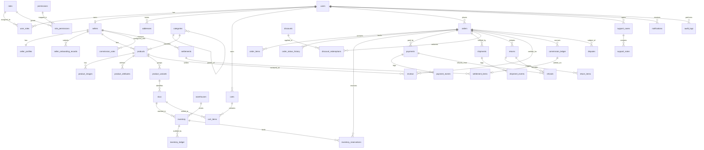

# MarketSphere — Database Design (`DATABASE_DESIGN.md`)

**Database Engine:** PostgreSQL 16/18+ (Primary System of Record)  
**ORM & Migration Tool:** Prisma ORM with versioned SQL migrations (`backend/prisma/migrations/`)  
**Financial Precision:** `DECIMAL(14, 2)` for currency amounts, `DECIMAL(7, 4)` for tax/commission rates — zero floating-point storage or arithmetic.

---

## 1. Entity Ownership & Separation

All 48 transactional, operational, and audit tables live in PostgreSQL and are owned exclusively by the Express.js backend. Python FastAPI never writes directly to PostgreSQL business tables; it evaluates stateless pricing, commission, feed normalization, and recommendation inputs passed by Express.

---

## 2. Entity-Relationship Diagram (Mermaid)

---

## 3. Complete Table Catalog (All 43 Required + 5 Supporting Tables)

### A. Identity, Auth & RBAC
1. **`users`**: `id` (UUID PK), `email` (unique), `password_hash`, `first_name`, `last_name`, `phone`, `status` (`ACTIVE|SUSPENDED|LOCKED|PENDING`), `primary_role`, `email_verified_at`, timestamps.
2. **`roles`**: `id`, `name` (`CUSTOMER|SELLER|WAREHOUSE_OPERATOR|SUPPORT_AGENT|ADMIN`), `description`.
3. **`permissions`**: `id`, `code` (e.g., `catalog:write`, `settlement:approve`), `description`.
4. **`user_roles`**: `user_id` FK -> `users`, `role_id` FK -> `roles`, composite PK `(user_id, role_id)`.
5. **`role_permissions`** *(supporting)*: composite PK `(role_id, permission_id)`.
6. **`refresh_tokens`** *(supporting)*: `id`, `user_id` FK, `token_hash` (unique), `family_id`, `expires_at`, `revoked_at`, `replaced_by_token_id`, `ip_address`, `user_agent`.
7. **`password_reset_tokens`** *(supporting)*: `id`, `user_id` FK, `token_hash` (unique), `expires_at`, `used_at`.
8. **`addresses`**: `id`, `user_id` FK -> `users`, `label`, `recipient_name`, `line1`, `line2`, `city`, `state`, `postal_code`, `country`, `phone`, `is_default`.

### B. Sellers & Onboarding
9. **`sellers`**: `id`, `user_id` (unique FK -> `users`), `store_name`, `store_slug` (unique), `onboarding_status` (`DRAFT|SUBMITTED|UNDER_REVIEW|APPROVED|REJECTED|SUSPENDED`), `commission_rate_override`, timestamps.
10. **`seller_profiles`**: `id`, `seller_id` (unique FK -> `sellers`), `legal_business_name`, `tax_id_masked`, `support_email`, `support_phone`, `payout_account_masked`, `return_policy`, `bio`, `logo_url`.
11. **`seller_onboarding_records`**: `id`, `seller_id` FK -> `sellers`, `step`, `document_type`, `storage_key`, `mime_type`, `file_size_bytes`, `checksum_sha256`, `status` (`PENDING|VERIFIED|REJECTED`), `reviewer_id` FK -> `users`, `reviewer_notes`, `reviewed_at`.

### C. Catalog & SKUs
12. **`categories`**: `id`, `name`, `slug` (unique), `parent_id` FK -> `categories`, `description`, `is_active`, `sort_order`.
13. **`products`**: `id`, `seller_id` FK -> `sellers`, `category_id` FK -> `categories`, `title`, `slug` (unique), `description`, `brand`, `status` (`DRAFT|PENDING_MODERATION|ACTIVE|REJECTED|ARCHIVED`), `moderation_notes`, `deleted_at`, timestamps.
14. **`product_images`**: `id`, `product_id` FK -> `products`, `url`, `storage_key`, `alt_text`, `sort_order`, `is_primary`.
15. **`product_attributes`**: `id`, `product_id` FK -> `products`, `name`, `value`.
16. **`product_variants`**: `id`, `product_id` FK -> `products`, `name`, `option_values` (JSONB), `is_active`.
17. **`skus`**: `id`, `product_id` FK -> `products`, `variant_id` FK -> `product_variants`, `sku_code` (unique), `barcode`, `price` (`DECIMAL(14,2)`), `compare_at_price`, `cost_price`, `currency` (`USD`), `weight_grams`, `is_active`, `deleted_at`. Check constraint: `price >= 0`.

### D. Warehouses, Inventory, Ledger & Concurrency Reservations
18. **`warehouses`**: `id`, `code` (unique), `name`, `seller_id` (nullable FK -> `sellers`, null = marketplace fulfillment center), `address_line1`, `city`, `state`, `postal_code`, `country`, `is_active`.
19. **`inventory`**: `id`, `sku_id` FK -> `skus`, `warehouse_id` FK -> `warehouses`, `on_hand_qty` (`INT`), `reserved_qty` (`INT`), `damaged_qty` (`INT`), `reorder_point` (`INT`), `version` (`INT`), `updated_at`.
    - Unique: `(sku_id, warehouse_id)`.
    - Check constraints: `on_hand_qty >= 0`, `reserved_qty >= 0`, `damaged_qty >= 0`, `reserved_qty <= on_hand_qty`.
20. **`inventory_ledger`**: `id`, `inventory_id` FK -> `inventory`, `sku_id` FK -> `skus`, `warehouse_id` FK -> `warehouses`, `movement_type` (`ADJUSTMENT_IN|ADJUSTMENT_OUT|RESERVE|RELEASE_EXPIRED|RELEASE_CANCELLED|COMMIT_SALE|DAMAGED|RETURN_RESTOCK`), `quantity_delta`, `balance_after`, `reference_type`, `reference_id`, `idempotency_key` (unique nullable), `actor_user_id` FK -> `users`, `notes`, `created_at`.
21. **`inventory_reservations`**: `id`, `inventory_id` FK -> `inventory`, `sku_id` FK -> `skus`, `warehouse_id` FK -> `warehouses`, `order_id` FK -> `orders`, `quantity` (`INT > 0`), `status` (`ACTIVE|COMMITTED|RELEASED|EXPIRED`), `idempotency_key` (unique), `expires_at`, `released_at`, `created_at`.

### E. Carts, Orders & Promotions
22. **`carts`**: `id`, `user_id` (nullable unique FK -> `users`), `session_token` (nullable unique), `currency`, `expires_at`, timestamps.
23. **`cart_items`**: `id`, `cart_id` FK -> `carts`, `sku_id` FK -> `skus`, `quantity` (`INT > 0`), `unit_price_snapshot` (`DECIMAL(14,2)`), timestamps. Unique `(cart_id, sku_id)`.
24. **`orders`**: `id`, `order_number` (unique), `customer_id` FK -> `users`, `status` (enum covering all 14 lifecycle states), `currency`, `subtotal_amount`, `discount_amount`, `tax_amount`, `shipping_amount`, `total_amount`, `shipping_address_snapshot` (JSONB), `discount_code`, `idempotency_key` (unique), `placed_at`, `cancelled_at`, timestamps.
25. **`order_items`**: `id`, `order_id` FK -> `orders`, `seller_id` FK -> `sellers`, `product_id` FK -> `products`, `sku_id` FK -> `skus`, `warehouse_id` FK -> `warehouses`, `product_title_snapshot`, `sku_code_snapshot`, `quantity` (`INT > 0`), `unit_price`, `discount_amount`, `tax_amount`, `line_total`, `fulfillment_status`.
26. **`order_status_history`**: `id`, `order_id` FK -> `orders`, `from_status`, `to_status`, `reason`, `changed_by_user_id` FK -> `users`, `created_at`.
27. **`discounts`**: `id`, `code` (unique uppercase), `seller_id` (nullable FK -> `sellers`), `discount_type` (`PERCENTAGE|FIXED`), `value` (`DECIMAL(14,2)`), `min_cart_amount`, `max_discount_amount`, `usage_limit_total`, `usage_limit_per_customer`, `used_count`, `is_stackable`, `starts_at`, `expires_at`, `is_active`. Check: `value > 0`, `used_count >= 0`.
28. **`discount_redemptions`**: `id`, `discount_id` FK -> `discounts`, `order_id` FK -> `orders`, `user_id` FK -> `users`, `discount_amount`, `created_at`. Unique `(discount_id, order_id)`.

### F. Payments, Shipping, Returns & Reviews
29. **`payments`**: `id`, `order_id` FK -> `orders`, `provider` (`SANDBOX_PAY`), `provider_payment_id` (unique nullable), `idempotency_key` (unique), `amount` (`DECIMAL(14,2)`), `currency`, `status` (`INITIATED|PENDING|CAPTURED|FAILED|PARTIALLY_REFUNDED|REFUNDED`), `failure_code`, `failure_message`, `captured_at`, timestamps.
30. **`payment_events`**: `id`, `payment_id` FK -> `payments`, `event_type`, `provider_event_id`, `payload` (JSONB), `created_at`. Unique `(payment_id, provider_event_id)` where non-null.
31. **`shipments`**: `id`, `order_id` FK -> `orders`, `seller_id` FK -> `sellers`, `warehouse_id` FK -> `warehouses`, `carrier`, `service_level`, `tracking_number` (unique nullable), `status` (`CREATED|PICKING|PACKED|READY_TO_SHIP|IN_TRANSIT|OUT_FOR_DELIVERY|DELIVERED|FAILED|RETURNED`), `shipped_at`, `delivered_at`, `failed_reason`, timestamps.
32. **`shipment_events`**: `id`, `shipment_id` FK -> `shipments`, `provider_event_id`, `status`, `location`, `description`, `occurred_at`, `raw_payload` (JSONB). Unique `(shipment_id, provider_event_id)`.
33. **`returns`**: `id`, `order_id` FK -> `orders`, `customer_id` FK -> `users`, `seller_id` FK -> `sellers`, `status` (`REQUESTED|SELLER_REVIEW|ESCALATED|APPROVED|REJECTED|RECEIVED|REFUNDED`), `reason`, `description`, `evidence_metadata` (JSONB), `resolution_notes`, `reviewed_by_user_id`, timestamps.
34. **`return_items`**: `id`, `return_id` FK -> `returns`, `order_item_id` FK -> `order_items`, `quantity` (`INT > 0`), `condition_status`.
35. **`refunds`**: `id`, `payment_id` FK -> `payments`, `order_id` FK -> `orders`, `return_id` (nullable FK -> `returns`), `provider_refund_id` (unique nullable), `idempotency_key` (unique), `amount` (`DECIMAL(14,2) > 0`), `status` (`PENDING|SUCCEEDED|FAILED`), `reason`, `processed_at`, timestamps.
36. **`reviews`**: `id`, `product_id` FK -> `products`, `user_id` FK -> `users`, `order_id` FK -> `orders`, `rating` (`INT 1..5`), `title`, `comment`, `is_verified_purchase`, `moderation_status` (`PENDING|APPROVED|HIDDEN|REJECTED`), timestamps. Unique `(product_id, user_id, order_id)`.

### G. Commissions, Settlements, Support, Governance & Platform
37. **`commission_rules`**: `id`, `name`, `seller_id` (nullable FK), `category_id` (nullable FK), `commission_type` (`PERCENTAGE|FIXED|HYBRID`), `percentage_rate`, `fixed_amount`, `priority`, `is_active`, timestamps.
38. **`commission_ledger`**: `id`, `order_id` FK -> `orders`, `order_item_id` (unique FK -> `order_items`), `seller_id` FK -> `sellers`, `commission_rule_id` (nullable FK), `gross_amount`, `discount_allocated`, `commission_amount`, `net_seller_amount`, `status` (`PENDING|EARNED|REVERSED|SETTLED`), timestamps.
39. **`settlements`**: `id`, `settlement_number` (unique), `seller_id` FK -> `sellers`, `period_start`, `period_end`, `gross_sales`, `total_commissions`, `total_refunds`, `net_payout`, `status` (`DRAFT|PENDING_APPROVAL|APPROVED|PAID|FAILED`), `approved_by_user_id`, `paid_at`, timestamps.
40. **`settlement_items`**: `id`, `settlement_id` FK -> `settlements`, `commission_ledger_id` (unique FK -> `commission_ledger`), `amount`.
41. **`disputes`**: `id`, `order_id` FK -> `orders`, `customer_id` FK -> `users`, `seller_id` FK -> `sellers`, `assigned_agent_id` (nullable FK -> `users`), `reason`, `status` (`OPEN|INVESTIGATING|ESCALATED|RESOLVED_BUYER|RESOLVED_SELLER|CLOSED`), `resolution_summary`, timestamps.
42. **`support_cases`** *(supporting)*: `id`, `case_number` (unique), `customer_id` FK -> `users`, `order_id` (nullable FK -> `orders`), `assigned_agent_id` (nullable FK -> `users`), `subject`, `priority` (`LOW|MEDIUM|HIGH|URGENT`), `status` (`OPEN|IN_PROGRESS|ESCALATED|RESOLVED|CLOSED`), timestamps.
43. **`support_notes`** *(supporting)*: `id`, `support_case_id` (nullable FK), `dispute_id` (nullable FK), `author_user_id` FK -> `users`, `is_internal`, `body`, `created_at`.
44. **`notifications`**: `id`, `user_id` FK -> `users`, `channel` (`IN_APP|EMAIL`), `type`, `title`, `message`, `metadata` (JSONB), `read_at`, `created_at`.
45. **`audit_logs`**: `id`, `actor_user_id` (nullable FK -> `users`), `actor_role`, `action`, `resource_type`, `resource_id`, `request_id`, `ip_address`, `before_state` (JSONB), `after_state` (JSONB), `created_at`.
46. **`idempotency_keys`**: `id`, `key` (unique), `scope`, `user_id` (nullable), `request_hash`, `response_status`, `response_body` (JSONB), `expires_at`, `created_at`.
47. **`webhook_events`**: `id`, `provider`, `provider_event_id`, `event_type`, `signature_valid`, `payload` (JSONB), `status` (`RECEIVED|PROCESSING|PROCESSED|FAILED`), `retry_count`, `last_error`, `processed_at`, timestamps. Unique `(provider, provider_event_id)`.
48. **`background_job_records`**: `id`, `queue_name`, `job_id`, `job_name`, `status` (`QUEUED|ACTIVE|COMPLETED|FAILED|DEAD_LETTER`), `attempts`, `payload` (JSONB), `result` (JSONB), `error_message`, `last_attempted_at`, `completed_at`, timestamps.
49. **`outbox_events`** *(supporting)*: `id`, `aggregate_type`, `aggregate_id`, `event_type`, `payload` (JSONB), `status` (`PENDING|DISPATCHED|FAILED`), `dispatched_at`, `created_at`.
50. **`system_configs`** *(supporting)*: `key` (PK), `value` (JSONB), `description`, `updated_by_user_id`, `updated_at`.

---

## 4. Index Strategy & Query Justification

| Index | Query Pattern Supported |
|---|---|
| `products(status, category_id, created_at DESC)` | Storefront filtered catalog listings & pagination without scanning drafts |
| `products(seller_id, status)` | Seller portal catalog table isolated by seller |
| `skus(product_id, is_active)` | Product detail variant/SKU lookup |
| `inventory(sku_id, warehouse_id)` UNIQUE | Single-row locking during checkout reservation |
| `inventory_reservations(status, expires_at)` | Periodic sweep for expired `ACTIVE` reservations |
| `orders(customer_id, created_at DESC)` | Customer order history sorted newest first |
| `order_items(seller_id, fulfillment_status)` | Seller order queue & warehouse fulfillment filters |
| `webhook_events(provider, provider_event_id)` UNIQUE | O(1) webhook replay & duplicate event detection |
| `audit_logs(resource_type, resource_id, created_at DESC)` | Admin audit investigation timelines |
| `commission_ledger(seller_id, status, created_at)` | Periodic seller settlement batch aggregation |

---

## 5. Transaction Boundaries

- **Inventory Reservation (`checkout`):** Single serializable/row-locked transaction locking `inventory` rows in ascending ID order, checking `on_hand_qty - reserved_qty >= requested_qty`, inserting `inventory_reservations`, updating `reserved_qty`, appending `inventory_ledger`, inserting `orders`, `order_items`, `order_status_history`, `discount_redemptions`, `payments`, and `outbox_events`.
- **Payment Webhook Confirmation:** Single transaction inserting/claiming `webhook_events`, locking `payments` and `orders`, transitioning `PENDING_PAYMENT -> PAYMENT_CONFIRMED`, converting `ACTIVE -> COMMITTED` reservations and decrementing `on_hand_qty` + `reserved_qty`, appending `inventory_ledger`, computing & persisting `commission_ledger`.
- **Refund Processing:** Single transaction locking `payments` and summing active/succeeded `refunds` to enforce `sum(refunds) + requested <= payment.amount` before persisting the refund record.
