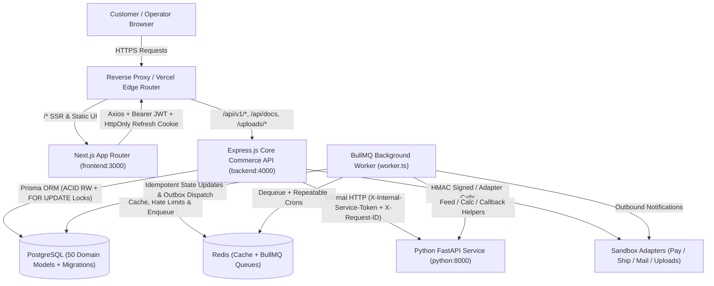
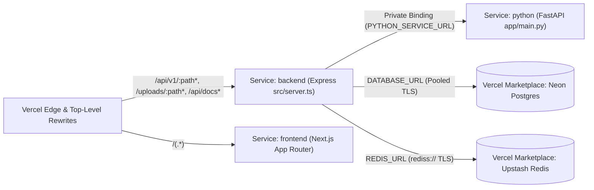
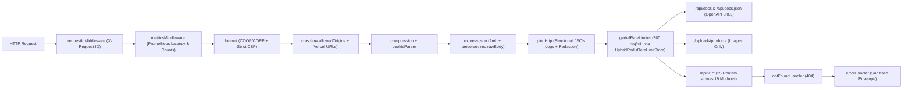
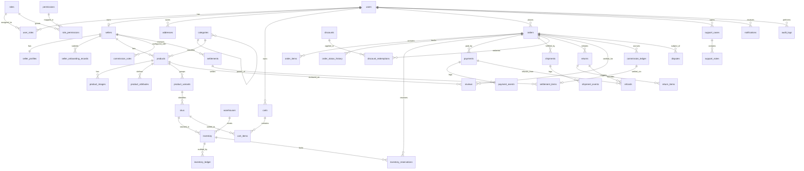
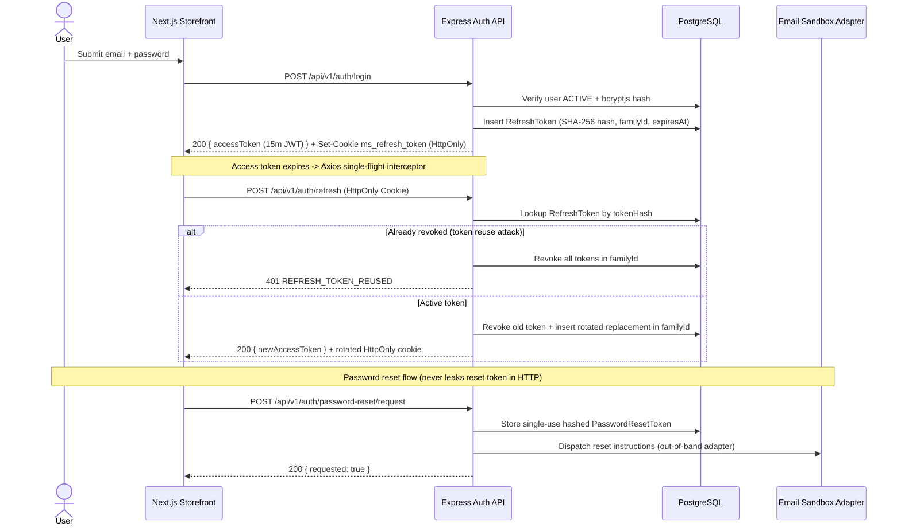
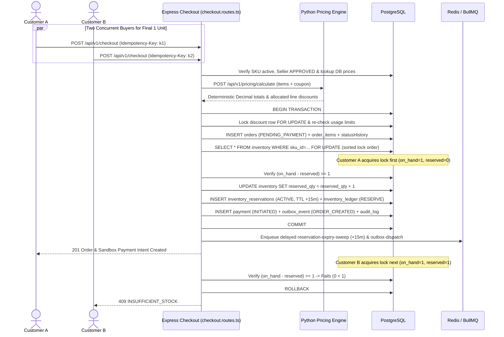
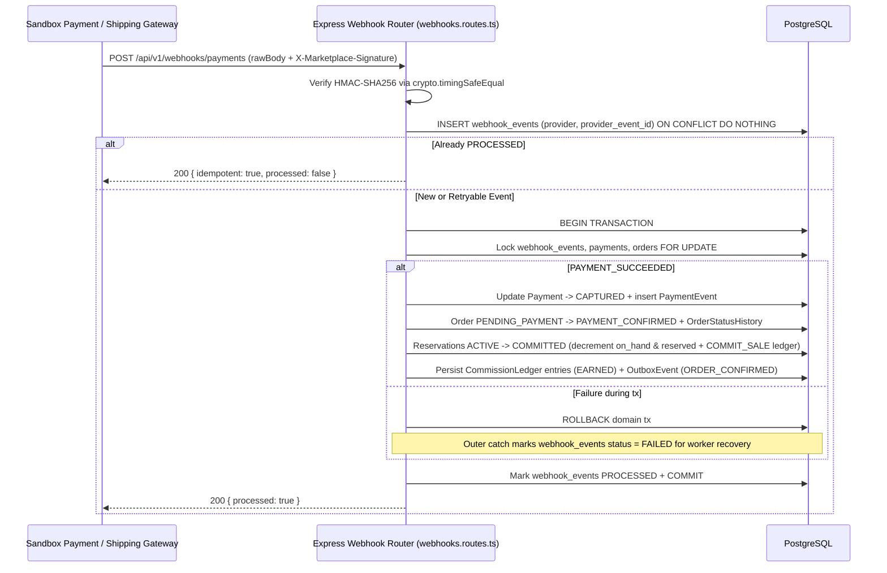
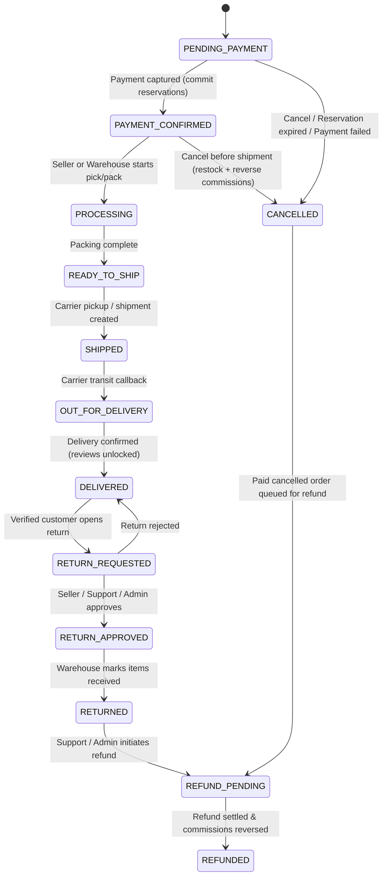

# MarketSphere — Complete Project Architecture, Design & Workflow Guide

**Project Name:** MarketSphere  
**Domain:** Enterprise Multi-Vendor E-Commerce Marketplace, Inventory & Order Management Platform  
**Repository Style:** Modular Monorepo (`frontend/`, `backend/`, `python-services/`, `infrastructure/`, `docs/`, `.github/`)  
**Live Production Deployment:** https://marketsphere-kappa.vercel.app *(Vercel Services Beta + Neon Postgres + Upstash Redis)*

---

## Table of Contents
1. [Executive Summary & Core Architectural Principles](#1-executive-summary--core-architectural-principles)
2. [Monorepo Structure & File Map](#2-monorepo-structure--file-map)
3. [Technology Stack & Bounded Service Ownership](#3-technology-stack--bounded-service-ownership)
4. [High-Level System Architecture & Deployment Topologies](#4-high-level-system-architecture--deployment-topologies)
5. [User Roles, Permissions & Frontend Portal Architecture](#5-user-roles-permissions--frontend-portal-architecture)
6. [Backend API Pipeline & Security Architecture](#6-backend-api-pipeline--security-architecture)
7. [Database Architecture (PostgreSQL + Prisma)](#7-database-architecture-postgresql--prisma)
8. [Core End-to-End Workflows](#8-core-end-to-end-workflows)
   - [8.1 Authentication, Refresh Token Rotation & Password Reset](#81-authentication-refresh-token-rotation--password-reset)
   - [8.2 Seller Onboarding, Catalog Governance & Bulk Feed Ingestion](#82-seller-onboarding-catalog-governance--bulk-feed-ingestion)
   - [8.3 Discovery, Explainable Recommendations & Cart Pricing](#83-discovery-explainable-recommendations--cart-pricing)
   - [8.4 Concurrency-Safe Checkout & Inventory Reservation](#84-concurrency-safe-checkout--inventory-reservation)
   - [8.5 Idempotent Payment & Shipping Webhooks](#85-idempotent-payment--shipping-webhooks)
   - [8.6 Order Fulfillment & 14-State Lifecycle Machine](#86-order-fulfillment--14-state-lifecycle-machine)
   - [8.7 Returns, Row-Locked Refunds, Commissions & Settlements](#87-returns-row-locked-refunds-commissions--settlements)
   - [8.8 Redis + BullMQ Background Workers & Transactional Outbox](#88-redis--bullmq-background-workers--transactional-outbox)
9. [Python FastAPI Calculation & Intelligence Subsystem](#9-python-fastapi-calculation--intelligence-subsystem)
10. [API Contracts, Observability, CI/CD & Testing Pyramid](#10-api-contracts-observability-cicd--testing-pyramid)
11. [Local Setup, Synthetic Demo Accounts & Verification Commands](#11-local-setup-synthetic-demo-accounts--verification-commands)

---

## 1. Executive Summary & Core Architectural Principles

MarketSphere is a full-stack multi-vendor commerce platform designed for five operational personas: **Customers**, **Sellers**, **Warehouse Operators**, **Support Agents**, and **Marketplace Administrators**. Every subsystem enforces strict invariants:

- **Single System of Record:** Express.js + Prisma ORM owns all **50 PostgreSQL domain tables** (`51` total tables including `_prisma_migrations`). Neither the frontend nor the Python service directly mutates commerce tables.
- **Zero Trust in Client Inputs:** Cart validation and checkout ignore client-submitted prices, totals, or role claims. Express queries authoritative `skus.price`, seller approval status, and stock from PostgreSQL and delegates deterministic tax/discount math to FastAPI.
- **Zero-Floating-Point Money Math:** Currency values use PostgreSQL `DECIMAL(14, 2)` (rates use `DECIMAL(7, 4)`), Node.js `decimal.js`, and Python `decimal.Decimal` with `ROUND_HALF_UP`.
- **Concurrency & Idempotency Guarantees:** Inventory reservations and refunds lock database rows (`SELECT ... FOR UPDATE`), enforce SQL `CHECK` constraints (`reserved_qty <= on_hand_qty`), and deduplicate retries via unique `idempotency_keys` and `webhook_events(provider, provider_event_id)`.
- **Graceful Degradation:** When Redis is unreachable (or during short-lived client disconnects), Express falls back cleanly (`HybridRedisRateLimitStore` switches to an in-memory map, reads bypass cache, and `enqueueTrackedJob` still persists job intent in `background_job_records` for later replay). When Python FastAPI times out, `pythonClient` falls back to matching `decimal.js` arithmetic (`source: "deterministic-fallback"`).

---

## 2. Monorepo Structure & File Map

```text
Marketsphere/
├── frontend/                              # Next.js 16 App Router, React 19, TypeScript, Tailwind CSS, Recharts
│   ├── src/app/                           # 14 route pages across Storefront & 4 Operational Portals
│   ├── src/components/                    # AppShell, ProtectedRoute, reusable UiPrimitives
│   ├── src/lib/api-client.ts              # Typed Axios client + memory token, X-CSRF-Token & silent refresh
│   ├── src/providers/AppProviders.tsx     # Redux Toolkit + TanStack Query + SessionBootstrap + Toasts
│   ├── src/store/index.ts                 # Redux slices: auth, toast, ui
│   ├── src/test/                          # Vitest + React Testing Library specs (2 files, 8 tests)
│   └── e2e/marketplace.spec.ts            # Full-stack Playwright Chromium E2E test
├── backend/                               # Express.js + TypeScript + Prisma + BullMQ Core Commerce Engine
│   ├── src/app.ts                         # Express middleware chain, Swagger UI (/api/docs), API router mount
│   ├── src/server.ts                      # HTTP entrypoint (guarded for serverless vs standalone listen)
│   ├── src/worker.ts                      # Standalone BullMQ worker daemon & repeatable cron scheduler
│   ├── src/config/env.ts                  # Zod-validated environment configuration + CORS/Vercel origins
│   ├── src/common/                        # Prisma singleton, Redis client, Decimal helpers, Pino logger,
│   │   ├── middleware/                    # Metrics (Prometheus), Safe Upload (magic bytes), RBAC/Auth, Rate Limit
│   ├── src/docs/openapi.ts                # OpenAPI 3.0.3 spec (106 operations — 100% route parity)
│   ├── src/integrations/                  # Python HTTP client + Sandbox adapters (Pay, Ship, Email)
│   ├── src/modules/                       # Domain modules: auth, users, sellers, catalog, inventory,
│   │                                      # cart, promotions, checkout, orders, payments, shipping, webhooks,
│   │                                      # returns, reviews, commissions, settlements, support, admin, health
│   ├── src/workers/                       # 4 BullMQ queues + 8 tracked job processors
│   ├── prisma/schema.prisma               # 50 normalized domain models, 25 enums, indexes
│   ├── prisma/migrations/                 # Versioned PostgreSQL DDL + SQL CHECK & pg_trgm constraints
│   ├── prisma/seed.ts                     # Idempotent synthetic dataset seeder (users, stores, catalog, stock)
│   └── tests/                             # 6 Vitest + Supertest integration & incident suites (41 tests)
├── python-services/                       # Python 3.13 + FastAPI + Pydantic v2 Stateless Calculation Tier
│   ├── app/main.py                        # FastAPI entrypoint
│   ├── app/core/                          # Config defaults (8.25% tax, $150 free shipping) & internal token check
│   ├── app/models/schemas.py              # Strict Pydantic Decimal models & validators
│   ├── app/api/v1/router.py               # REST endpoints (/health, /pricing, /commissions, /feeds, /recommendations)
│   ├── app/services/                      # pricing_service.py, feed_service.py, recommendation_service.py
│   └── tests/                             # pytest suite (11 tests) + 2,000-row CSV/pricing benchmark
├── infrastructure/
│   ├── nginx/                             # nginx.conf (HTTP proxy) & nginx.tls.conf (HTTPS TLS termination)
│   ├── postgres/init.sql                  # Postgres extension bootstrap (uuid-ossp / pg_trgm)
│   ├── prometheus/prometheus.yml          # Prometheus scrape job for /api/v1/health/metrics
│   └── scripts/                           # backup-restore-verify.ps1, generate-local-tls.ps1 / .sh
├── docs/
│   ├── assessments/                       # Mandatory Assessment 01–15 reports + Playwright screenshots
│   ├── postman/                           # Postman v2.1 collection (32 requests across 6 folders)
│   ├── INTEGRATION_AUDIT_REPORT.md        # 10-point integration audit verification report
│   └── FINAL_EVALUATION_REPORT.md         # Post-fix independent technical evaluation scorecard
├── .github/workflows/ci-cd.yml            # 8-job GitHub Actions CI/CD & rollback pipeline
├── docker-compose.yml                     # 7-container local/staging stack
└── vercel.json                            # Vercel Services Beta config (frontend, backend, python + bindings)
```

---

## 3. Technology Stack & Bounded Service Ownership

| Service / Layer | Stack & Libraries | Owned Responsibilities | Strict Boundaries |
|---|---|---|---|
| **Frontend Portal Tier (`frontend/`)** | Next.js 15 (App Router), React 19, TypeScript, Tailwind CSS v4, Redux Toolkit, TanStack Query, React Hook Form + Zod, Axios, Lucide | UI rendering, client navigation, client state, cached data fetching, form validation UX | Never acts as security authority; never calculates final totals or bypasses RBAC |
| **Core Commerce Backend (`backend/`)** | Node.js 22, Express 4, TypeScript 5.8, Prisma 6.12, `decimal.js`, `ioredis`, `bcryptjs`, `jsonwebtoken`, Zod 4, Helmet, Pino, Swagger UI | Auth/JWT/RBAC, seller isolation, catalog & SKUs, inventory ledger & `FOR UPDATE` locks, cart/checkout, orders, payments, shipping, returns/refunds, commissions, settlements, audit logs, webhook handlers | Never delegates primary persistence to Python or client; never returns raw SQL/stack traces |
| **Background Worker Daemon (`backend/src/worker.ts`)** | BullMQ 5, Redis 7, Prisma Outbox | Delayed expiry sweeps, outbox email dispatch, low-stock alerts, payment reconciliation, failed webhook recovery, async carrier callbacks, feed imports, settlement batches | Persists state in PostgreSQL `background_job_records`; Redis unavailability cannot lose business intent |
| **Python Calculation Tier (`python-services/`)** | Python 3.13, FastAPI 0.115, Pydantic 2.10, Uvicorn, `httpx`, `Decimal`, `pytest`, `ruff` | Deterministic subtotal/coupon/tax/shipping math, commission breakdowns, streaming CSV/JSON catalog feed validation & normalization, explainable recommendations | Stateless compute only; never owns a competing database for orders, inventory, or users |
| **Data & Edge Infra** | PostgreSQL 16/18, Redis 7, Nginx 1.27, Prometheus, Vercel Services (Beta) + Neon + Upstash | Relational ACID storage, cache/rate-limits/queues, TLS & path routing, metrics scraping | Internal services and DB ports stay private behind Nginx / Vercel bindings |

---

## 4. High-Level System Architecture & Deployment Topologies

### 4.1 Logical Component & Data Flow Diagram



### 4.2 Container Topology (`docker-compose.yml`)

For self-hosted Docker Compose deployments, MarketSphere defines **7 containers** communicating across a private `marketsphere-net` bridge network:
1. `postgres` (`postgres:16-alpine`) initialized with `infrastructure/postgres/init.sql` (`postgres_data` volume)
2. `redis` (`redis:7-alpine` with `--appendonly yes --maxmemory-policy noeviction`, `redis_data` volume)
3. `python-service` (port `8000`, FastAPI Uvicorn non-root container)
4. `backend` (port `4000`, Express API, mounts `backend_uploads`)
5. `background-worker` (`node dist/worker.js`, shares backend image)
6. `frontend` (port `3000`, Next.js production server)
7. `nginx` (`nginx:1.27-alpine` ports `80`/`443`, routes `/api/` -> `backend:4000`, `/_next/static/` & `/` -> `frontend:3000`, exposes `/nginx-health`)

### 4.3 Serverless Cloud Topology (`vercel.json` — Vercel Services Beta)

MarketSphere is deployed to Vercel at **`https://marketsphere-kappa.vercel.app`** using **Vercel Services** *(Beta on all plans)*:



- Because **Express** guards `app.listen(...)` with `if (!process.env.VERCEL)` in `backend/src/server.ts`, the same codebase runs seamlessly as a long-lived HTTP daemon locally/in Docker and as a Vercel Function handler in production.
- **Note on Serverless Background Processing:** Long-lived `node dist/worker.js` BullMQ loops do not run continuously inside serverless functions; maintenance/outbox/expiry tasks remain runnable via the Admin Console (`POST /api/v1/admin/jobs/trigger` or `/replay` with `{ executeNow: true }`) or via an external/containerized worker connected to the same Neon + Upstash stores.

---

## 5. User Roles, Permissions & Frontend Portal Architecture

### 5.1 Role-Based Access Control (5 Roles & 20 Granular Permissions)

Seeded via `backend/prisma/seed.ts` across PostgreSQL `roles`, `permissions`, `role_permissions`, and `user_roles`:

| Role (`RoleName`) | Granted Permissions | Accessible Portal(s) |
|---|---|---|
| `CUSTOMER` | `catalog:read`, `cart:manage`, `orders:read_own`, `returns:request` | Storefront (`/`), Product Detail (`/products/[slug]`), `/cart`, `/checkout`, `/orders`, `/orders/[orderId]`, `/account` |
| `SELLER` | `catalog:read`, `catalog:write`, `inventory:read`, `inventory:write`, `orders:read_seller`, `orders:fulfill`, `sellers:onboard`, `returns:review`, `commissions:read` | `/seller` + Storefront & `/account` (data isolated to caller's `sellerId`) |
| `WAREHOUSE_OPERATOR` | `catalog:read`, `inventory:read`, `inventory:write`, `orders:read_all`, `orders:fulfill` | `/warehouse` + `/account` |
| `SUPPORT_AGENT` | `catalog:read`, `orders:read_all`, `returns:review`, `refunds:process`, `support:manage` | `/support` + `/account` |
| `ADMIN` | All **20 permissions** (`catalog:moderate`, `sellers:approve`, `orders:manage`, `commissions:manage`, `admin:audit`, plus all role permissions above) | `/admin` + every role portal above |

### 5.2 Frontend Routes & Client State Architecture

All **14 App Router `page.tsx` routes** live under `frontend/src/app/` and wrap inside `AppProviders` (`frontend/src/providers/AppProviders.tsx`) and `AppShell` (`frontend/src/components/layout/AppShell.tsx`):

- **Public & Customer Routes:** `/`, `/products/[slug]`, `/login`, `/register`, `/forgot-password`, `/cart`, `/checkout`, `/orders`, `/orders/[orderId]`, `/account`
- **Role-Gated Portals (`ProtectedRoute`):** `/seller` (`SELLER`, `ADMIN`), `/warehouse` (`WAREHOUSE_OPERATOR`, `ADMIN`), `/support` (`SUPPORT_AGENT`, `ADMIN`), `/admin` (`ADMIN`)
- **Session & Token Storage (`frontend/src/lib/api-client.ts`):**
  - Short-lived JWT access tokens (`15m`) are cached in memory + `sessionStorage` (`ms_access_token`); legacy `localStorage` entries are actively purged.
  - Refresh tokens are stored strictly as **`HttpOnly` cookies** (`ms_refresh_token`) managed by `/api/v1/auth`.
  - When any API call receives `401`, Axios queues behind a single-flight `refreshPromise` calling `POST /api/v1/auth/refresh` with `withCredentials: true` and transparently replays the original request.
- **Client State (`frontend/src/store/index.ts`):**
  - **Redux Toolkit (`store`):** Minimal client-global state for `auth` (`user`, `hydrated`), `toast` (auto-dismissing viewport alerts), and `ui` (`cartCount`).
  - **TanStack Query:** Server-state caching (`staleTime: 20_000`, `retry: 1`) across storefront listings, dashboards, orders, and operational consoles.

---

## 6. Backend API Pipeline & Security Architecture

### 6.1 Express Middleware & Route Mounting (`backend/src/app.ts`)

Every inbound HTTP request passes through the exact pipeline below:



### 6.2 Security Hardening Layers

1. **Authentication & Brute-Force Protection:** Passwords hashed with `bcryptjs` (cost factor 12). Auth routes apply a stricter `25 requests / 15 min` rate limiter (`authRateLimiter`). Refresh tokens are 48-byte random values hashed with SHA-256 in PostgreSQL (`refresh_tokens`); reuse of an already revoked token revokes the entire `family_id`.
2. **Authorization & Isolation:** `authenticate` verifies the user still exists and has `status === ACTIVE`. `orders.routes.ts` blocks cross-customer access (`403 ORDER_PRIVACY_VIOLATION`), and seller endpoints call `assertSellerOwnership` (`403 SELLER_ISOLATION_VIOLATION`).
3. **Upload Hardening (`backend/src/common/upload.ts`):** Validates allowlisted extensions/MIME types, `5 MiB` file limit, binary magic-byte signatures (`%PDF`, JPEG, PNG, WEBP), SHA-256 file checksums, and canonical path containment. Seller KYC documents live outside static public routes.
4. **Webhook Signature Verification:** `/api/v1/webhooks/payments` and `/api/v1/webhooks/shipping` verify HMAC-SHA256 signatures against `req.rawBody` using `crypto.timingSafeEqual`.
5. **Parameterized Persistence & Error Hygiene:** Prisma query builders and tagged `$queryRaw` prevent SQL injection; `errorHandler` maps `ZodError`, Prisma constraint errors (`P2002`, `23514`), and domain `AppError` subclasses into standard JSON envelopes without leaking stack traces.

---

## 7. Database Architecture (PostgreSQL + Prisma)

PostgreSQL holds **50 domain models**, **25 enums** (`backend/prisma/schema.prisma`), SQL `CHECK` constraints, and GIN `pg_trgm` trigram search indexing (`products_title_trgm_idx`).

### 7.1 Entity-Relationship Overview



### 7.2 Model Catalog Across 7 Domains (50 Models)

1. **Identity, Auth & Addresses (8):** `User`, `Role`, `Permission`, `UserRole`, `RolePermission`, `RefreshToken`, `PasswordResetToken`, `Address`
2. **Sellers & KYC Onboarding (3):** `Seller`, `SellerProfile`, `SellerOnboardingRecord`
3. **Catalog & Variants (6):** `Category`, `Product`, `ProductImage`, `ProductAttribute`, `ProductVariant`, `Sku` (`CHECK price >= 0`)
4. **Warehouses, Stock & Concurrency Control (4):** `Warehouse`, `Inventory` (`UNIQUE (sku_id, warehouse_id)` + SQL `CHECK` constraints `on_hand_qty >= 0`, `reserved_qty >= 0`, `damaged_qty >= 0`, `reserved_qty <= on_hand_qty`), `InventoryLedger`, `InventoryReservation`
5. **Cart, Promotions & Orders (7):** `Cart`, `CartItem`, `Order`, `OrderItem`, `OrderStatusHistory`, `Discount` (`CHECK value > 0`, `used_count >= 0`), `DiscountRedemption`
6. **Payments, Fulfillment, Returns & Reviews (8):** `Payment`, `PaymentEvent`, `Shipment`, `ShipmentEvent`, `ReturnRequest`, `ReturnItem`, `Refund`, `Review`
7. **Commissions, Support, Audit & Platform Reliability (14):** `CommissionRule`, `CommissionLedger`, `Settlement`, `SettlementItem`, `SupportCase`, `Dispute`, `SupportNote`, `Notification`, `AuditLog`, `IdempotencyKey`, `WebhookEvent`, `BackgroundJobRecord`, `OutboxEvent`, `SystemConfig`

---

## 8. Core End-to-End Workflows

### 8.1 Authentication, Refresh Token Rotation & Password Reset



### 8.2 Seller Onboarding, Catalog Governance & Bulk Feed Ingestion

1. **Onboarding (`POST /api/v1/sellers/register` -> `PATCH /api/v1/sellers/:sellerId/status`):** Users submit store metadata (`DRAFT` -> `SUBMITTED`/`UNDER_REVIEW`) and KYC files (`POST /api/v1/sellers/me/documents`, checked for magic bytes & SHA-256). Only `ADMIN` can move sellers to `APPROVED`, `REJECTED`, or `SUSPENDED`.
2. **Product Moderation:** Approved sellers create products/variants/SKUs (`DRAFT` -> `PENDING_MODERATION`), which admins approve (`ACTIVE`) or reject (`PATCH /api/v1/admin/products/:productId/moderate`). Only `ACTIVE` products under `APPROVED` sellers are returned in storefront search or eligible for checkout.
3. **Bulk Catalog Feed Import (`POST /api/v1/seller/products/feed-import`):** Sellers upload CSV or JSON payloads synchronously or asynchronously (`async=true` queues `feed-import` onto `marketsphere-feed-import`). Express forwards payloads to Python `POST /api/v1/feeds/process`, receives normalized titles/SKUs/prices + row error diagnostics, and upserts categories, products, SKUs, and opening warehouse inventory inside PostgreSQL.

### 8.3 Discovery, Explainable Recommendations & Cart Pricing

- **Storefront Filtering & SQL Sorting (`GET /api/v1/products`):** Supports search (`pg_trgm`), `category`, `minPrice`, `maxPrice`, `sellerId`, `inStock` (`on_hand_qty - reserved_qty > 0`), price sorting (`ORDER BY MIN(s.price)` executed in SQL *before* `LIMIT`/`OFFSET`), and pagination metadata.
- **Recommendations (`GET /api/v1/products/recommendations` & `/:productId/recommendations`):** Express collects active candidate product vectors (plus authenticated customer order/category history when signed in) and calls Python `POST /api/v1/recommendations`. Cold-start visitors receive popularity-ranked picks (`deterministic-cold-start-popularity`), product views blend category & token similarity (`item-similarity-popularity`), and logged-in shoppers receive `hybrid-personalized-similarity` picks with human-readable reasons.
- **Authoritative Cart Validation (`POST /api/v1/cart/validate`):** Recomputes line subtotals, coupon eligibility (`WELCOME10`, `SAVE20`, seller-scoped codes, min-cart rules), allocated item discounts, `8.25%` tax, and `$150.00` free-shipping thresholds via FastAPI (`pricing.source = "python-fastapi"`).

### 8.4 Concurrency-Safe Checkout & Inventory Reservation



### 8.5 Idempotent Payment & Shipping Webhooks



- Calling `POST /api/v1/webhooks/shipping?async=true` validates the HMAC signature immediately, queues `shipping-status-callback` onto BullMQ (`202 Accepted`), and lets workers invoke `shippingService.processShippingWebhook`.
- Any webhook throwing inside its transaction persists `status = 'FAILED'` outside the rolled-back transaction so `failed-webhook-recovery` can automatically replay `SANDBOX_PAY` and `SANDBOX_SHIP` events up to 5 retries.

### 8.6 Order Fulfillment & 14-State Lifecycle Machine



Shipments (`shipments` + `shipment_events`) also support partial multi-seller/multi-warehouse fulfillment per order item (`OrderItemFulfillmentStatus`), updating overall order status cleanly once all items advance.

### 8.7 Returns, Row-Locked Refunds, Commissions & Settlements

1. **Returns (`returns.routes.ts`):** Only the customer owning a `DELIVERED` order may request a return (`POST /api/v1/returns`). Sellers (isolated to their items), Support Agents, and Admins decide outcomes (`SELLER_REVIEW`, `ESCALATED`, `APPROVED`, `REJECTED`, `RECEIVED`), optionally restocking returned inventory (`RETURN_RESTOCK` ledger entry).
2. **Refunds (`POST /api/v1/refunds`):** Restricted to `SUPPORT_AGENT` and `ADMIN` with an `Idempotency-Key`. Inside a transaction, Express locks the `payments` row (`FOR UPDATE`), sums prior `SUCCEEDED`/`PENDING` refunds, rejects over-limit amounts (`amount > payment.amount - alreadyRefunded`), invokes `paymentSandboxAdapter`, reverses commission ledger rows, and updates `Payment` to `PARTIALLY_REFUNDED` or `REFUNDED`.
3. **Commissions & Settlements (`commissions.routes.ts`, `settlements.routes.ts`):**
   - Rules match in precedence: Seller Override -> `(sellerId, categoryId)` -> `(sellerId, global)` -> `(global, categoryId)` -> `(global, global)` -> default 10%.
   - Admins generate periodic seller payouts (`POST /api/v1/settlements/generate`, optionally async via `settlement-batch` queue), aggregating `EARNED` and `REVERSED` commission ledger rows into atomic `settlements` + `settlement_items` batches (`DRAFT` -> `PENDING_APPROVAL` -> `APPROVED` -> `PAID`).

### 8.8 Redis + BullMQ Background Workers & Transactional Outbox

Configured in `backend/src/workers/queues.ts`, `backend/src/workers/processors.ts`, and `backend/src/worker.ts` across **4 queues** (`3` attempts with `2000ms` exponential backoff):

| Registered Job Name | BullMQ Queue | Repeatable Interval (`worker.ts`) | Responsibility |
|---|---|---|---|
| `outbox-dispatch` | `marketsphere-notifications` | Every `15s` | Polls `outbox_events (PENDING)`, resolves recipient, sends email via `emailSandboxAdapter`, marks `DISPATCHED` / `FAILED` |
| `reservation-expiry-sweep` | `marketsphere-maintenance` | Every `60s` (+ delayed `15m` per checkout) | Releases expired `ACTIVE` reservations, decrements `reserved_qty`, logs `RELEASE_EXPIRED`, cancels unpaid orders |
| `failed-webhook-recovery` | `marketsphere-maintenance` | Every `180s` (`3m`) | Retries `FAILED` `SANDBOX_PAY` & `SANDBOX_SHIP` webhooks (`retryCount < 5`) |
| `low-stock-alerts` | `marketsphere-maintenance` | Every `300s` (`5m`) | Alerts sellers (`LOW_STOCK_ALERT` notification deduplicated daily) when `available <= reorderPoint` |
| `payment-reconciliation` | `marketsphere-maintenance` | Every `300s` (`5m`) | Backfills missing `CommissionLedger` entries on confirmed orders & closes orphaned `INITIATED` payments on cancelled orders |
| `shipping-status-callback` | `marketsphere-maintenance` | On demand (`POST /webhooks/shipping?async=true`) | Signs and replays carrier status webhook callbacks through `shippingService` |
| `feed-import` | `marketsphere-feed-import` | On demand (async seller CSV/JSON upload) | Streams large feed through Python FastAPI & persists normalized SKUs/inventory |
| `settlement-batch` | `marketsphere-settlements` | Every `3600s` (`1h`) + on demand | Generates seller payout statements & links ledger entries |

Every job tracks lifecycle transitions (`QUEUED` -> `ACTIVE` -> `COMPLETED` / `FAILED` / `DEAD_LETTER` after 3 failed attempts) inside PostgreSQL `background_job_records`. Admins can inspect, trigger (`POST /api/v1/admin/jobs/trigger`), or replay (`POST /api/v1/admin/jobs/:jobId/replay`) any job from `/admin`.

---

## 9. Python FastAPI Calculation & Intelligence Subsystem

Exposed at `/api/v1/*` inside `python-services/app/api/v1/router.py` (all business routes guarded by `X-Internal-Service-Token`):

1. **Deterministic Pricing Engine (`POST /api/v1/pricing/calculate`):** Accepts items, optional coupon (`PERCENTAGE` / `FIXED`, `seller_id` scoping, `min_cart_amount`, `max_discount_amount`), and `tax_rate` (default `0.0825`). Allocates item-level discounts proportionally without penny drift so `sum(line_discounts) === total_discount`, applies tax post-discount, waives shipping at `>= $150.00` (otherwise `$9.99` flat rate), and rounds strictly via `ROUND_HALF_UP`.
2. **Commission Math (`POST /api/v1/commissions/calculate`):** Evaluates `PERCENTAGE`, `FIXED`, `HYBRID`, seller overrides, and priority ordering (invoked by Express `/api/v1/commissions/calculate` and pre-payment settlement webhook/reconciliation flows with `decimal.js` fallback).
3. **Catalog Feed Normalizer (`POST /api/v1/feeds/process` & `POST /api/v1/feeds/upload`):** Streams CSV (`csv.DictReader`) or JSON arrays up to 10 MiB, normalizes column aliases (`title`/`product_title`/`name`, `sku`/`variant_sku`, `qty`/`stock`), strips currency formatting, deduplicates SKUs, validates regex `^[A-Z0-9_-]{3,80}$`, and outputs clean items + per-row error details (`2,000` rows benchmarked at `55.56 ms`).
4. **Recommendation Service (`POST /api/v1/recommendations` & `GET /api/v1/recommendations/{customer_id}`):** Scores candidate products dynamically from Express catalog vectors using popularity weight (`0.4x`), category affinity (`+35`), anchor category match (`+40`), title token Jaccard + keyword overlap, and price proximity (`+10 * min/max`), plus `Precision@K` / `Recall@K` / `NDCG@K` ranking evaluation (`Precision@3 >= 0.66`, `NDCG@3 >= 0.85`). Returns `strategy="stateless-catalog-required", recommendations=[]` cleanly on `GET` when no catalog payload is supplied.

---

## 10. API Contracts, Observability, CI/CD & Testing Pyramid

- **Standard Envelope:** Every Express response returns `{ success, message, data, meta?, requestId }` (or `{ success: false, message, code, details?, requestId }`).
- **Interactive Documentation:** Swagger UI is served directly at `/api/docs` (trailing-slash redirect disabled, assets served locally or via CSP-scoped CDN fallback) with OpenAPI 3.0.3 JSON at `/api/docs.json` covering **all `106` Express API operations (`0` missing)**, plus a **32-request / 6-folder** Postman collection (`docs/postman/marketsphere.postman_collection.json`).
- **Health & Prometheus Metrics:** `GET /api/v1/health` checks live PostgreSQL (`SELECT 1`), Redis (`ping`), and FastAPI (`/api/v1/health`, `5000ms` timeout), returning `status: "ok" | "degraded"` (`?strict=true` returns `503` when degraded). `GET /api/v1/health/metrics` exports `marketsphere_dependency_up`, `marketsphere_process_uptime_seconds`, `marketsphere_process_resident_memory_bytes`, `marketsphere_outbox_events_pending`, `marketsphere_background_jobs_total`, `marketsphere_http_request_duration_ms_*`, and `marketsphere_http_requests_total` (`infrastructure/prometheus/prometheus.yml`).
- **GitHub Actions CI/CD (`.github/workflows/ci-cd.yml`):** 8-job workflow executing `backend-ci` (PostgreSQL 16 + Redis 7 + FastAPI + Prisma + Vitest + `--audit-level=moderate` audit), `python-ci` (`ruff` + `pytest` + benchmark), `frontend-ci` (`typecheck` + `lint` + RTL Vitest + `next build` + `--audit-level=moderate` audit), `e2e-ci` (full-stack Playwright Chromium), `docker-build` (multi-image Buildx + `docker compose config --quiet` + `nginx -t`), `deploy-staging`, `deploy-production` (manual environment gate), and manual `rollback-production`.
- **Testing & Verification Suites:**
  - **Backend (`backend/tests/`):** 6 integration test suites (`auth_security`, `commerce_concurrency`, `integration_audit`, `webhooks_refunds_workers`, `incidents`, `modules_coverage`) totaling **41 tests** (`80.18%` stmts/lines coverage with `75/75/70/60` enforced gates).
  - **Python (`python-services/tests/`):** **11 pytest cases** (`96.0%` trace coverage) covering math rounding, CSV/JSON feeds, multipart upload, cold-start/Jaccard recommendations, and `Precision@K`/`NDCG@K` evaluation, plus `benchmark.py`.
  - **Frontend (`frontend/src/test/` & `frontend/e2e/`):** **8 React Testing Library specs across 2 files** + Playwright full-stack Chromium E2E across Customer, Seller, Warehouse, Support, and Admin flows (`docs/assessments/screenshots/`).
  - **Operations Scripts (`infrastructure/scripts/`):** Verified `pg_dump` / `pg_restore` backup integrity script (`backup-restore-verify.ps1`) and TLS certificate generators (`generate-local-tls.ps1` / `.sh`).

---

## 11. Local Setup, Synthetic Demo Accounts & Verification Commands

### 11.1 Synthetic Seed Accounts (`backend/prisma/seed.ts`)
*(Shared demo password: `MarketSphere#2026`)*

| Role | Email | Store / Area |
|---|---|---|
| Customer (Primary) | `customer@marketsphere.test` | Storefront, Cart, Checkout, Orders, Returns |
| Customer (Secondary) | `customer2@marketsphere.test` | Multi-customer isolation verification |
| Seller (Approved) | `seller1@marketsphere.test` | Approved store & catalog management (`/seller`) |
| Seller (Approved #2) | `seller2@marketsphere.test` | Multi-vendor split-order & isolation checks |
| Seller (Pending/Review) | `seller3@marketsphere.test` | Onboarding review workflow testing |
| Warehouse Operator | `warehouse@marketsphere.test` | Inventory adjustments, pick/pack/ship (`/warehouse`) |
| Support Agent | `support@marketsphere.test` | Cases, disputes, returns & refunds (`/support`) |
| Marketplace Admin | `admin@marketsphere.test` | Moderation, seller approvals, commissions, settlements, jobs (`/admin`) |

### 11.2 Quick Verification Commands

```powershell
# 1. Database migration & idempotent seed
npx --prefix backend prisma migrate deploy --schema=backend/prisma/schema.prisma
npm --prefix backend run prisma:seed

# 2. Run test suites across all 3 runtimes
npm --prefix backend test
npm --prefix frontend test
python-services\.venv\Scripts\pytest.exe python-services/tests

# 3. Full containerized stack (requires Docker)
docker compose up --build
```

---

### Existing Specialized Reference Documents
For deep dives beyond this unified guide, consult:
- [CODEBASE.md](file:///C:/Users/chinn/Downloads/Marketsphere/CODEBASE.md)
- [SYSTEM_DESIGN.md](file:///C:/Users/chinn/Downloads/Marketsphere/SYSTEM_DESIGN.md)
- [DATABASE_DESIGN.md](file:///C:/Users/chinn/Downloads/Marketsphere/DATABASE_DESIGN.md)
- [API_DOCUMENTATION.md](file:///C:/Users/chinn/Downloads/Marketsphere/API_DOCUMENTATION.md)
- [SECURITY.md](file:///C:/Users/chinn/Downloads/Marketsphere/SECURITY.md)
- [DEPLOYMENT.md](file:///C:/Users/chinn/Downloads/Marketsphere/DEPLOYMENT.md)
- [TESTING.md](file:///C:/Users/chinn/Downloads/Marketsphere/TESTING.md)
- [IMPLEMENTATION_STATUS.md](file:///C:/Users/chinn/Downloads/Marketsphere/IMPLEMENTATION_STATUS.md)
- [FINAL_EVALUATION_REPORT.md](file:///C:/Users/chinn/Downloads/Marketsphere/docs/FINAL_EVALUATION_REPORT.md)
