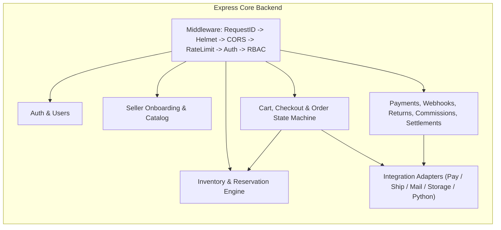
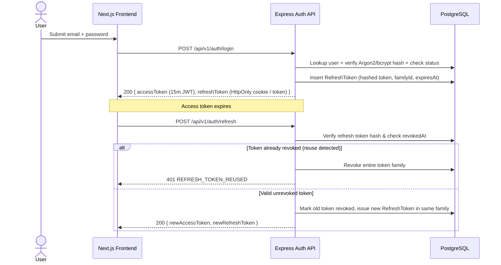
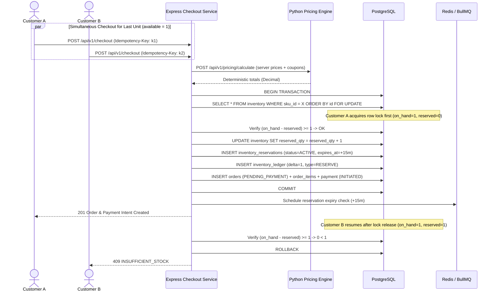
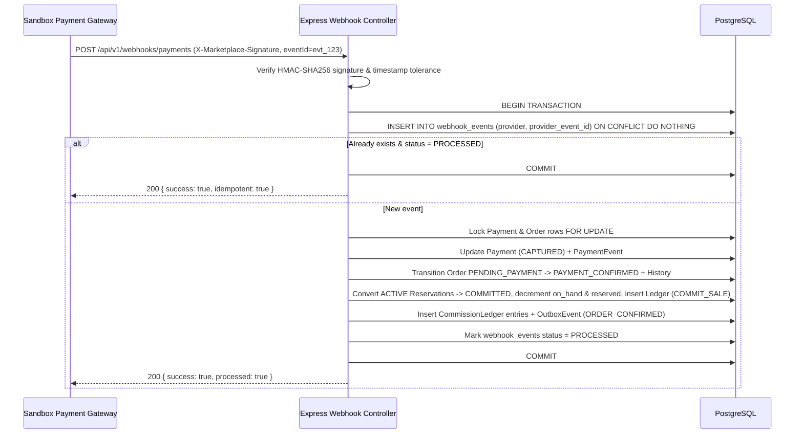
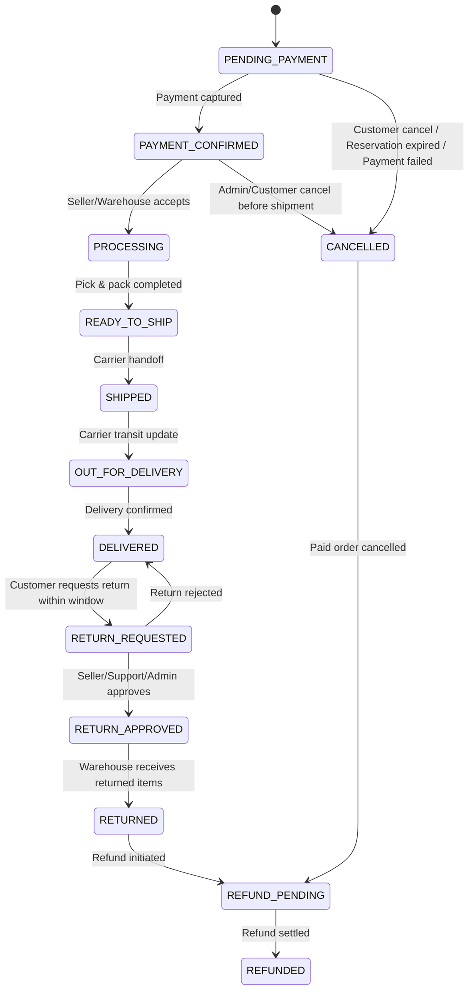
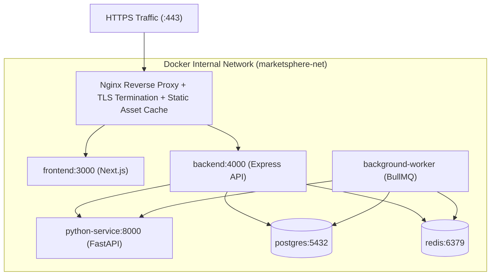

# MarketSphere — System Design & Architecture (`SYSTEM_DESIGN.md`)

---

## 1. Architectural Overview

MarketSphere uses a **modular monorepo** separating four independently deployable runtime tiers behind an Nginx reverse proxy:

1. **Frontend (`frontend/`)**: Next.js App Router (React + TypeScript + Tailwind CSS) serving the Customer Storefront and role-gated Seller, Warehouse, Support, and Admin portals.
2. **Core Commerce Backend (`backend/`)**: Node.js + Express.js + TypeScript + Prisma ORM acting as the **sole authoritative commerce orchestrator** and database owner.
3. **Background Worker Runtime (`backend/src/worker.ts`)**: BullMQ + Redis asynchronous workers coupled with PostgreSQL transactional outbox / job tracking records.
4. **Python Calculation & Intelligence Service (`python-services/`)**: FastAPI + Pydantic service providing stateless, deterministic pricing/promotion evaluation, commission math, bulk catalog feed normalization, and explainable product recommendations.
5. **Data Infrastructure**: PostgreSQL (authoritative relational store) and Redis (cache, rate-limit store, BullMQ queues, short-lived distributed locks).

---

## 2. High-Level System Architecture Diagram

```mermaid
flowchart TB
    Client["Browser / Mobile Client"] -->|HTTPS / REST| Nginx["Nginx Reverse Proxy"]
    Nginx -->|"/* (SSR & Static)"| Frontend["Next.js App Router (Port 3000)"]
    Nginx -->|"/api/v1/* & /api/docs"| Backend["Express.js Core API (Port 4000)"]

    Frontend -->|Typed Axios Client + JWT| Nginx
    Backend -->|Prisma ORM (Authoritative RW)| Postgres[("PostgreSQL 16+")]
    Backend -->|Cache & BullMQ Enqueue| Redis[("Redis 7+")]
    Backend -->|Internal Service HTTP + HMAC/Token| FastAPI["Python FastAPI Service (Port 8000)"]
    Backend -->|Sandbox Adapters| Sandbox["Sandbox Gateways (Pay / Ship / Mail / Storage)"]

    Worker["BullMQ Background Workers"] -->|Consume Jobs| Redis
    Worker -->|Idempotent Updates & Audit| Postgres
    Worker -->|Bulk Feed / Calc Calls| FastAPI
    Worker -->|Email / Webhook Retry| Sandbox
```

---

## 3. Bounded Service Responsibilities & Ownership

| Layer | Owns | Must Never Do |
|---|---|---|
| **Frontend (Next.js)** | UI state (Redux Toolkit), server cache (TanStack Query), form UX (RHF+Zod), route presentation | Enforce authoritative RBAC/pricing/stock rules; embed secrets |
| **Backend (Express.js)** | Auth, RBAC, Seller isolation, Catalog, Inventory reservations & ledger, Cart, Checkout, Orders, Payments, Shipping, Returns/Refunds, Commissions, Settlements, Audit | Delegate authoritative order/payment/stock persistence to Python or client |
| **Python Service (FastAPI)** | Deterministic pricing/promotions, commission rules evaluation, streaming CSV/JSON catalog feed normalization, recommendation ranking & cold-start fallback | Maintain a separate database of orders, payments, inventory, or customer PII |
| **Redis + BullMQ** | Reservation expiry sweep scheduling, async emails/notifications, payment reconciliation, feed batch processing, settlement batch generation | Act as sole unpersisted truth for financial or stock state transitions |

---

## 4. Inter-Service Component Diagram



---

## 5. Critical Sequence Diagrams

### 5.1 Authentication & Refresh Token Rotation Flow



### 5.2 Concurrency-Safe Inventory Reservation & Checkout Sequence



### 5.3 Idempotent Payment Webhook Sequence



### 5.4 Order Lifecycle State Machine



---

## 6. Deployment & Network Topology


